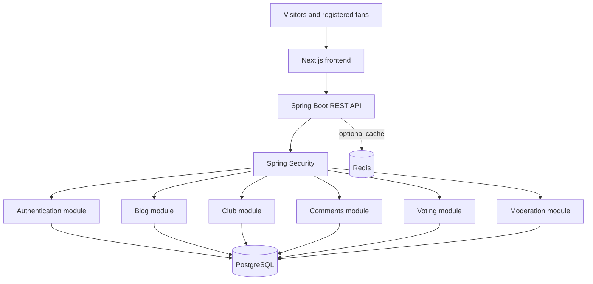
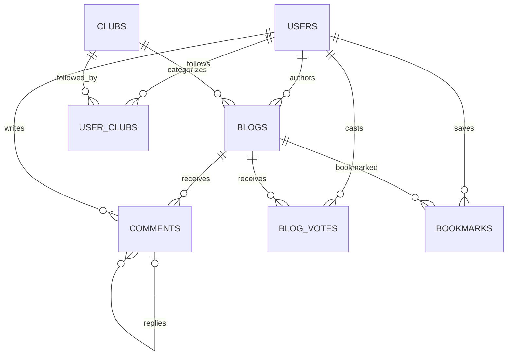

# FootballHub — Full-Stack Football Blogging Platform
## Implementation Plan, Architecture, API Specification, and Day-One Build Guide

**Document version:** 1.0  
**Prepared:** 25 October 2026  
**Project type:** Full-stack web application  
**Primary focus:** English Premier League football blogs and fan community  
**Backend:** Java 21 + Spring Boot  
**Frontend:** Next.js + TypeScript  
**Database:** PostgreSQL

---

## 1. Executive summary

FootballHub is a football publication and community platform. Readers can browse articles about Premier League clubs, while registered users can publish their own analysis, comment on posts, reply to comments, upvote articles, bookmark posts, and follow clubs. Moderators and administrators can review reported content and manage the community.

The initial product should be built as a **modular monolith**: one Spring Boot backend organized into feature modules, one Next.js frontend, and one PostgreSQL database. This approach is easier to develop and deploy than microservices while retaining clean module boundaries.

### Day-one MVP

The first working release should include:

- Registration, login, logout, and current-user profile.
- Public home feed and club-specific pages.
- Blog creation, editing, publishing, and deletion by the author.
- Blog upvotes and vote removal, with duplicate votes prevented by the database.
- Comments and replies.
- Bookmarks and followed clubs.
- Search, filtering, sorting, and pagination.
- Basic report and moderation workflows.
- Automated tests for critical user journeys.
- Local development setup using Docker Compose.

Email delivery, social login, live scores, sophisticated recommendations, real-time chat, and production-grade deployment can follow after the core journey works.

## 2. Product requirements

### 2.1 User types

| User type | Capabilities |
|---|---|
| Guest | Browse public articles, club pages, and visible comments; search content |
| Registered user | Publish blogs, vote, comment, reply, bookmark, follow clubs, edit own profile |
| Moderator | Review reports and hide/remove content according to policy |
| Administrator | Manage roles, users, club metadata, moderation, and site configuration |

### 2.2 Main pages

| Route | Purpose |
|---|---|
| `/` | Homepage: featured, latest, and trending posts |
| `/login` | Login form |
| `/register` | Registration form |
| `/blogs/[slug]` | Article detail page |
| `/clubs/[slug]` | Club-specific feed |
| `/write` | Blog editor |
| `/profile/[username]` | Public author profile |
| `/bookmarks` | User's saved articles |
| `/dashboard` | User's own drafts, published posts, and activity |
| `/settings` | Profile and account settings |
| `/admin` | Moderation and administration |

### 2.3 Core user stories

1. As a visitor, I can read public articles without creating an account.
2. As a visitor, I can register with a unique email and username.
3. As a registered user, I can log in and log out securely.
4. As an author, I can save a draft and publish an article.
5. As an author, I can edit or delete my own article.
6. As a reader, I can upvote an article once and remove my vote.
7. As a reader, I can add comments and reply to existing comments.
8. As a reader, I can bookmark an article and follow clubs.
9. As a moderator, I can review reported content and record an action.
10. As a user, I can browse by club, keyword, publication date, and popularity.

### 2.4 Non-functional requirements

- Secure authentication and server-side authorization.
- Data integrity under concurrent requests.
- Responsive layout for mobile and desktop.
- Accessible controls, keyboard navigation, and useful form errors.
- Pagination for all potentially large collections.
- Structured logs, health checks, and automated tests.
- Search-engine-friendly public article pages.
- Database migrations that are reproducible in development, test, and production.
- No secrets or production credentials in source control.

## 3. Technology stack

| Layer | Recommended technology | Purpose |
|---|---|---|
| Frontend | Next.js + TypeScript | Responsive UI, server rendering, routing |
| UI styling | Tailwind CSS + component library | Design system and reusable components |
| Backend | Java 21 + Spring Boot | REST API and business logic |
| Security | Spring Security | Authentication and authorization |
| Persistence | Spring Data JPA / Hibernate | Database access |
| Database | PostgreSQL | Durable relational data |
| Migrations | Flyway | Versioned schema changes |
| Validation | Jakarta Bean Validation | Validate API inputs |
| API documentation | Springdoc OpenAPI | Interactive API documentation |
| Testing | JUnit 5, Mockito, Spring Boot Test | Unit and integration tests |
| Database integration tests | Testcontainers | Test with real PostgreSQL |
| Browser testing | Playwright | End-to-end user flows |
| Local infrastructure | Docker Compose | Repeatable local database setup |
| Optional cache/jobs | Redis + a job library | Caching and asynchronous tasks |
| Media storage | S3-compatible object storage | Article covers and avatars |
| Monitoring | Spring Boot Actuator + log/error monitoring | Health and operational visibility |

Use a Java version supported by the selected Spring Boot release. Java 21 is a sensible LTS baseline. Verify dependency versions as a compatible set before implementation; do not blindly copy an old version number from an example.

## 4. Architecture

### 4.1 High-level architecture



### 4.2 Request lifecycle

1. The browser sends an HTTP request.
2. Spring Security authenticates the session or token.
3. The controller validates path, query, and body parameters.
4. The service enforces business rules and ownership.
5. The repository reads or writes PostgreSQL.
6. The API returns a documented response and appropriate HTTP status.
7. The frontend updates its state and displays success or failure.

### 4.3 Why a modular monolith

Do not begin with microservices. The initial workload does not justify the added networking, deployment, tracing, and distributed transaction complexity. Use modules with clear responsibilities, and extract services later only when traffic, team boundaries, or independent scaling justify it.

## 5. Repository layout

```text
footballhub/
├── README.md
├── docker-compose.yml
├── .gitignore
├── backend/
│   ├── pom.xml
│   ├── Dockerfile
│   └── src/
│       ├── main/
│       │   ├── java/com/footballhub/
│       │   │   ├── FootballHubApplication.java
│       │   │   ├── config/
│       │   │   ├── security/
│       │   │   ├── common/
│       │   │   │   ├── exception/
│       │   │   │   └── dto/
│       │   │   ├── auth/
│       │   │   ├── user/
│       │   │   ├── blog/
│       │   │   ├── comment/
│       │   │   ├── vote/
│       │   │   ├── club/
│       │   │   ├── bookmark/
│       │   │   ├── notification/
│       │   │   └── moderation/
│       │   └── resources/
│       │       ├── application.yml
│       │       └── db/migration/
│       └── test/
├── frontend/
│   ├── package.json
│   ├── .env.local.example
│   ├── app/
│   ├── components/
│   ├── lib/
│   └── types/
└── docs/
    ├── architecture.md
    └── api.md
```

### 5.1 Backend class responsibilities

| Component | Responsibility |
|---|---|
| Controller | HTTP mapping and DTO binding; no business logic |
| Service | Business rules, transactions, ownership checks |
| Repository | Database queries |
| Entity | Persistent domain state |
| Request DTO | Validated incoming payload |
| Response DTO | Stable public API representation |
| Mapper | Entity-to-response conversion |
| Exception handler | Consistent error responses |
| Tests | Validate business rules and API behavior |

Organize code by feature. Avoid a single enormous controller or service. Do not expose JPA entities directly through the public API.

## 6. Data model

### 6.1 Core tables

| Table | Purpose |
|---|---|
| `users` | Accounts, usernames, profile fields, password hashes |
| `roles` or user role field | User, moderator, administrator permissions |
| `clubs` | Club metadata and slugs |
| `blogs` | Article content, author, slug, status, timestamps |
| `comments` | Comments and replies |
| `blog_votes` | One vote per user per blog |
| `bookmarks` | Saved blogs |
| `user_clubs` | Clubs followed by users |
| `user_follows` | Optional author-follow relationship |
| `notifications` | Replies, moderation updates, and other alerts |
| `content_reports` | Reported blogs and comments |
| `blog_revisions` | Optional article edit history |
| `audit_logs` | Important administrative actions |

### 6.2 Relationships



### 6.3 Schema design requirements

- `users.email` and `users.username` must be unique.
- `blogs.slug` must be unique.
- `blog_votes` must have a unique key on `(user_id, blog_id)`.
- `bookmarks` must have a unique key on `(user_id, blog_id)`.
- `user_clubs` must have a unique key on `(user_id, club_id)`.
- Use foreign keys for relationships.
- Use a nullable parent comment ID for replies.
- Use statuses such as `DRAFT`, `PUBLISHED`, and `ARCHIVED`.
- Add indexes for publication date, club, author, comment thread, and vote lookups.
- Use Flyway migrations; configure Hibernate to validate, not automatically mutate, the schema.

### 6.4 Initial Flyway migration

Create `backend/src/main/resources/db/migration/V1__initial_schema.sql`.

```sql
CREATE TABLE users (
    id BIGINT GENERATED ALWAYS AS IDENTITY PRIMARY KEY,
    username VARCHAR(30) NOT NULL UNIQUE,
    email VARCHAR(255) NOT NULL UNIQUE,
    password_hash VARCHAR(255) NOT NULL,
    display_name VARCHAR(80) NOT NULL,
    role VARCHAR(20) NOT NULL DEFAULT 'USER',
    enabled BOOLEAN NOT NULL DEFAULT FALSE,
    created_at TIMESTAMPTZ NOT NULL DEFAULT NOW(),
    updated_at TIMESTAMPTZ NOT NULL DEFAULT NOW(),
    CONSTRAINT users_role_check
        CHECK (role IN ('USER', 'MODERATOR', 'ADMIN'))
);

CREATE TABLE clubs (
    id BIGINT GENERATED ALWAYS AS IDENTITY PRIMARY KEY,
    name VARCHAR(100) NOT NULL,
    slug VARCHAR(120) NOT NULL UNIQUE,
    league VARCHAR(80) NOT NULL DEFAULT 'Premier League',
    description TEXT,
    created_at TIMESTAMPTZ NOT NULL DEFAULT NOW()
);

CREATE TABLE blogs (
    id BIGINT GENERATED ALWAYS AS IDENTITY PRIMARY KEY,
    author_id BIGINT NOT NULL REFERENCES users(id),
    club_id BIGINT REFERENCES clubs(id),
    title VARCHAR(180) NOT NULL,
    slug VARCHAR(220) NOT NULL UNIQUE,
    excerpt VARCHAR(400),
    content TEXT NOT NULL,
    status VARCHAR(20) NOT NULL DEFAULT 'DRAFT',
    vote_count INTEGER NOT NULL DEFAULT 0,
    created_at TIMESTAMPTZ NOT NULL DEFAULT NOW(),
    updated_at TIMESTAMPTZ NOT NULL DEFAULT NOW(),
    published_at TIMESTAMPTZ,
    CONSTRAINT blogs_status_check
        CHECK (status IN ('DRAFT', 'PUBLISHED', 'ARCHIVED')),
    CONSTRAINT blogs_vote_count_check CHECK (vote_count >= 0)
);

CREATE TABLE comments (
    id BIGINT GENERATED ALWAYS AS IDENTITY PRIMARY KEY,
    blog_id BIGINT NOT NULL REFERENCES blogs(id),
    author_id BIGINT NOT NULL REFERENCES users(id),
    parent_id BIGINT REFERENCES comments(id),
    content VARCHAR(3000) NOT NULL,
    status VARCHAR(20) NOT NULL DEFAULT 'VISIBLE',
    created_at TIMESTAMPTZ NOT NULL DEFAULT NOW(),
    updated_at TIMESTAMPTZ NOT NULL DEFAULT NOW(),
    CONSTRAINT comments_status_check
        CHECK (status IN ('VISIBLE', 'HIDDEN', 'REMOVED')),
    CONSTRAINT comments_not_self_parent
        CHECK (parent_id IS NULL OR parent_id <> id)
);

CREATE TABLE blog_votes (
    user_id BIGINT NOT NULL REFERENCES users(id),
    blog_id BIGINT NOT NULL REFERENCES blogs(id),
    created_at TIMESTAMPTZ NOT NULL DEFAULT NOW(),
    PRIMARY KEY (user_id, blog_id)
);

CREATE TABLE bookmarks (
    user_id BIGINT NOT NULL REFERENCES users(id),
    blog_id BIGINT NOT NULL REFERENCES blogs(id),
    created_at TIMESTAMPTZ NOT NULL DEFAULT NOW(),
    PRIMARY KEY (user_id, blog_id)
);

CREATE TABLE user_clubs (
    user_id BIGINT NOT NULL REFERENCES users(id),
    club_id BIGINT NOT NULL REFERENCES clubs(id),
    created_at TIMESTAMPTZ NOT NULL DEFAULT NOW(),
    PRIMARY KEY (user_id, club_id)
);

CREATE TABLE content_reports (
    id BIGINT GENERATED ALWAYS AS IDENTITY PRIMARY KEY,
    reporter_id BIGINT NOT NULL REFERENCES users(id),
    blog_id BIGINT REFERENCES blogs(id),
    comment_id BIGINT REFERENCES comments(id),
    reason VARCHAR(500) NOT NULL,
    status VARCHAR(20) NOT NULL DEFAULT 'OPEN',
    created_at TIMESTAMPTZ NOT NULL DEFAULT NOW(),
    CONSTRAINT reports_target_check CHECK (
        (blog_id IS NOT NULL AND comment_id IS NULL)
        OR (blog_id IS NULL AND comment_id IS NOT NULL)
    ),
    CONSTRAINT reports_status_check
        CHECK (status IN ('OPEN', 'REVIEWING', 'RESOLVED', 'DISMISSED'))
);

CREATE INDEX idx_blogs_published
    ON blogs (published_at DESC, id DESC)
    WHERE status = 'PUBLISHED';

CREATE INDEX idx_blogs_club
    ON blogs (club_id, published_at DESC)
    WHERE status = 'PUBLISHED';

CREATE INDEX idx_blogs_author
    ON blogs (author_id, created_at DESC);

CREATE INDEX idx_comments_blog
    ON comments (blog_id, created_at ASC);

CREATE INDEX idx_comments_parent
    ON comments (parent_id);

CREATE INDEX idx_votes_blog ON blog_votes (blog_id);
CREATE INDEX idx_reports_status
    ON content_reports (status, created_at DESC);
```

**Important:** this is a starting schema. Add verification tokens, password-reset tokens, notifications, author follows, tags, and any stronger cross-blog comment-parent constraints in later migrations. Define deletion and retention behavior explicitly before launch.

`vote_count` is a cached aggregate. If maintained, update it in the same transaction as the vote insert/delete, and only when a row was actually inserted/deleted. Alternatively, calculate counts from `blog_votes` until measurement shows that a cached counter is needed.

## 7. API specification

Use `/api/v1` as the versioned API prefix.

### 7.1 Authentication

| Method | Endpoint | Access |
|---|---|---|
| POST | `/api/v1/auth/register` | Public |
| POST | `/api/v1/auth/login` | Public |
| POST | `/api/v1/auth/logout` | Authenticated |
| GET | `/api/v1/users/me` | Authenticated |
| POST | `/api/v1/auth/forgot-password` | Public |
| POST | `/api/v1/auth/reset-password` | Public, token required |
| POST | `/api/v1/auth/verify-email` | Public, token required |

### 7.2 Blogs

| Method | Endpoint | Purpose |
|---|---|---|
| GET | `/api/v1/blogs` | List, search, filter, sort, paginate |
| GET | `/api/v1/blogs/{slug}` | Read published article |
| POST | `/api/v1/blogs` | Create draft or article |
| PUT | `/api/v1/blogs/{id}` | Edit own blog or admin-managed blog |
| DELETE | `/api/v1/blogs/{id}` | Delete own blog or admin-managed blog |
| POST | `/api/v1/blogs/{id}/publish` | Publish a draft |
| POST | `/api/v1/blogs/{id}/archive` | Archive a blog |

### 7.3 Community

| Method | Endpoint | Purpose |
|---|---|---|
| POST | `/api/v1/blogs/{id}/vote` | Upvote |
| DELETE | `/api/v1/blogs/{id}/vote` | Remove upvote |
| GET | `/api/v1/blogs/{id}/comments` | List comments |
| POST | `/api/v1/blogs/{id}/comments` | Add comment |
| PUT | `/api/v1/comments/{id}` | Edit own comment |
| DELETE | `/api/v1/comments/{id}` | Remove own comment |
| POST | `/api/v1/blogs/{id}/bookmark` | Bookmark |
| DELETE | `/api/v1/blogs/{id}/bookmark` | Remove bookmark |
| POST | `/api/v1/clubs/{id}/follow` | Follow club |
| DELETE | `/api/v1/clubs/{id}/follow` | Unfollow club |

### 7.4 Moderation

| Method | Endpoint | Purpose |
|---|---|---|
| POST | `/api/v1/reports` | Report a blog or comment |
| GET | `/api/v1/admin/reports` | Review reports |
| POST | `/api/v1/admin/reports/{id}/resolve` | Resolve or dismiss report |
| POST | `/api/v1/admin/blogs/{id}/hide` | Hide a blog |
| POST | `/api/v1/admin/comments/{id}/hide` | Hide a comment |
| PATCH | `/api/v1/admin/users/{id}/role` | Change role, admin only |

### 7.5 API behavior

- `200 OK`: successful read or update.
- `201 Created`: created resource.
- `204 No Content`: successful deletion with no response body.
- `400 Bad Request`: invalid request.
- `401 Unauthorized`: missing or invalid authentication.
- `403 Forbidden`: authenticated user lacks permission.
- `404 Not Found`: resource unavailable or intentionally concealed.
- `409 Conflict`: unique constraint or state conflict.
- `429 Too Many Requests`: rate limit exceeded.

Use pagination and stable sorting on collection endpoints. Never accept the authenticated author's ID, role, vote count, or moderation status from a normal user as trusted data.

## 8. Authentication and security

### 8.1 Recommended approach

Use Spring Security with a server-managed session for the browser application. This is a good starting point when the frontend and backend are deployed under the same site.

- Hash passwords using a modern password-hashing algorithm such as Argon2id.
- Use HTTP-only, Secure, appropriately configured SameSite cookies.
- Enable CSRF protection for state-changing browser requests when using cookie-based sessions.
- Verify email before granting publishing privileges.
- Implement single-use, expiring password-reset tokens.
- Rate-limit login, registration, comments, and voting.
- Derive user IDs from the authenticated principal, not request payloads.
- Check resource ownership in service methods.
- Sanitize rich-text content and safely render it to prevent XSS.
- Keep secrets in environment variables or a secret manager.
- Avoid storing long-lived credentials in browser local storage.
- Configure CORS only for the actual frontend origins if cross-origin requests are required.
- Do not expose stack traces, database errors, or secrets to API clients.

### 8.2 Authorization matrix

| Action | Guest | User | Moderator | Admin |
|---|---:|---:|---:|---:|
| Read published blogs | Yes | Yes | Yes | Yes |
| Vote and comment | No | Yes | Yes | Yes |
| Create blog | No | Yes | Yes | Yes |
| Edit own blog | No | Yes | Yes | Yes |
| Moderate content | No | No | Yes | Yes |
| Change user roles | No | No | No | Yes |

Ownership checks are separate from role checks. A user must not be able to edit another person's article by guessing its numeric ID.

## 9. Backend implementation guide

### 9.1 Maven dependencies

Create a Spring Boot Maven project with these dependencies:

- `spring-boot-starter-web`
- `spring-boot-starter-security`
- `spring-boot-starter-data-jpa`
- `spring-boot-starter-validation`
- `spring-boot-starter-actuator`
- `org.postgresql:postgresql`
- `org.flywaydb:flyway-core`
- `org.flywaydb:flyway-database-postgresql`
- `org.springdoc:springdoc-openapi-starter-webmvc-ui`
- `spring-boot-starter-test`
- `spring-security-test`
- Testcontainers PostgreSQL modules for integration tests

Let the Spring Boot parent manage compatible dependency versions where possible. Verify compatibility before building. Use a Java version supported by the chosen Boot release.

### 9.2 Configuration

Example `application.yml`:

```yaml
spring:
  application:
    name: footballhub-api
  datasource:
    url: ${DATABASE_URL:jdbc:postgresql://localhost:5432/footballhub}
    username: ${DATABASE_USERNAME:footballhub}
    password: ${DATABASE_PASSWORD:footballhub_dev}
  jpa:
    open-in-view: false
    hibernate:
      ddl-auto: validate
  flyway:
    enabled: true

server:
  port: 8080
  error:
    include-message: never
    include-stacktrace: never

management:
  endpoints:
    web:
      exposure:
        include: health,info
```

The fallback credentials are for local development only. Do not use them in a public environment. Flyway owns schema changes; Hibernate validates mappings.

### 9.3 Application entry point

```java
package com.footballhub;

import org.springframework.boot.SpringApplication;
import org.springframework.boot.autoconfigure.SpringBootApplication;

@SpringBootApplication
public class FootballHubApplication {
    public static void main(String[] args) {
        SpringApplication.run(FootballHubApplication.class, args);
    }
}
```

### 9.4 Blog entity design

The `Blog` JPA entity should map to `blogs` and include:

- `id`
- `author` as a lazy `ManyToOne` relationship
- `club` as a relationship to the club entity
- `title`, `slug`, `excerpt`, and `content`
- `status`
- `voteCount` if maintaining a cached aggregate
- `createdAt`, `updatedAt`, and `publishedAt`

Use a `BlogStatus` enum with `DRAFT`, `PUBLISHED`, and `ARCHIVED`. Add lifecycle timestamp handling. Avoid serializing entity graphs directly to prevent lazy-loading errors and accidental data exposure.

### 9.5 DTOs

`CreateBlogRequest` should validate:

- Title: required, maximum 180 characters.
- Excerpt: optional, maximum 400 characters.
- Content: required, with an appropriate maximum.
- Club ID: optional, but must refer to an existing club.

`BlogResponse` should expose only public fields, such as ID, title, slug, excerpt, author username, club, status where appropriate, vote count, and publication timestamp.

The authenticated author is set by the backend. Generate a unique slug server-side, validate club IDs, and map the entity to the response DTO.

### 9.6 Service-layer rules

A `BlogService` should:

1. Validate referenced club IDs.
2. Set the author from the authenticated principal.
3. Generate a collision-safe slug.
4. Save new content as a draft unless publishing is explicitly requested.
5. Allow editing only by the author or a suitably authorized administrator.
6. Set publication timestamps when a blog is first published.
7. Prevent guests from creating or mutating content.
8. Return DTOs rather than JPA entities.

Keep controllers thin. Put transactional business operations in services.

### 9.7 Voting implementation

Use a database uniqueness constraint on `(user_id, blog_id)`. PostgreSQL conflict handling can make insertion idempotent:

```sql
INSERT INTO blog_votes (user_id, blog_id)
VALUES (:userId, :blogId)
ON CONFLICT (user_id, blog_id) DO NOTHING;
```

Only increment a cached count if the insert created a row. On removal, decrement only if a row was deleted. Perform the change transactionally. The user ID must come from the security context.

For an initial release, calculating the count from `blog_votes` is acceptable and avoids cached-count synchronization complexity. Add caching only when measurements justify it.

### 9.8 Comments implementation

A comment contains a blog ID, author ID, optional parent comment ID, content, status, and timestamps.

- Verify that the blog is published and commentable.
- Verify that a reply's parent belongs to the same blog.
- Restrict editing/deletion to the author or authorized moderator.
- Sanitize rendered content.
- Paginate comments on large articles.
- Provide report and moderation controls.

### 9.9 Error handling

Use a global exception handler with a consistent error shape, for example:

```json
{
  "status": 400,
  "code": "VALIDATION_ERROR",
  "message": "Please correct the highlighted fields.",
  "timestamp": "2026-10-25T12:00:00Z"
}
```

Do not expose stack traces or raw SQL errors. Include field-level validation errors where useful, without disclosing private data.

## 10. Frontend implementation guide

### 10.1 Visual direction

Use a premium football editorial design:

- Dark navy or neutral background with restrained club-inspired accents.
- Strong headline typography and readable long-form text.
- Large editorial hero images with properly licensed assets.
- Responsive article cards.
- Clear upvote and comment controls.
- Visible club navigation.
- Accessible contrast, keyboard navigation, and focus states.

Do not use unlicensed club logos or photographs. Club names and user-created text can be used appropriately, but trademark and media rights should be considered before public launch.

### 10.2 Create the app

From the repository root:

```bash
npx create-next-app@latest frontend \
  --typescript \
  --tailwind \
  --eslint \
  --app \
  --src-dir \
  --import-alias "@/*"
```

Recommended page structure:

```text
frontend/src/
├── app/
│   ├── page.tsx
│   ├── login/page.tsx
│   ├── register/page.tsx
│   ├── blogs/[slug]/page.tsx
│   ├── clubs/[slug]/page.tsx
│   ├── write/page.tsx
│   ├── profile/[username]/page.tsx
│   ├── bookmarks/page.tsx
│   ├── dashboard/page.tsx
│   └── admin/page.tsx
├── components/
│   ├── navigation/
│   ├── blog/
│   ├── comments/
│   ├── forms/
│   └── layout/
├── lib/
│   ├── api.ts
│   └── auth.ts
└── types/
```

### 10.3 API client requirements

The frontend API client should:

- Use a configurable base URL.
- Include credentials when using session cookies.
- Handle CSRF tokens for mutations.
- Parse error responses into useful messages.
- Handle `204 No Content`.
- Avoid trusting frontend role checks for security.
- Provide loading, empty, error, and success states.

A production implementation should use Next.js `Link` for navigation and typed response contracts. The API should define consistent pagination and error formats.

### 10.4 Essential UI components

- `SiteHeader`
- `ClubNavigation`
- `BlogCard`
- `FeaturedArticle`
- `BlogFeed`
- `BlogEditor`
- `VoteButton`
- `BookmarkButton`
- `CommentList`
- `CommentForm`
- `UserAvatar`
- `ClubCard`
- `Pagination`
- `LoginForm`
- `RegisterForm`
- `ReportDialog`
- `AdminModerationTable`

### 10.5 Frontend behavior

- Guests can read published blogs.
- Guests attempting to vote, comment, bookmark, or publish are directed to login.
- A vote count changes only after the server confirms the operation.
- Drafts are visible only to their author and authorized staff.
- Forms display validation errors near the relevant fields.
- Blog content is rendered safely; do not render arbitrary raw HTML.
- The homepage and article pages should have SEO metadata and canonical URLs.

## 11. Local development with Docker Compose

Create `docker-compose.yml` at the repository root:

```yaml
services:
  postgres:
    image: postgres:16
    environment:
      POSTGRES_DB: footballhub
      POSTGRES_USER: footballhub
      POSTGRES_PASSWORD: footballhub_dev
    ports:
      - "5432:5432"
    volumes:
      - footballhub_data:/var/lib/postgresql/data
    healthcheck:
      test: ["CMD-SHELL", "pg_isready -U footballhub -d footballhub"]
      interval: 5s
      timeout: 3s
      retries: 10

volumes:
  footballhub_data:
```

These credentials are for local development only.

### Start PostgreSQL

```bash
docker compose up -d postgres
docker compose ps
```

### Start Spring Boot

From `backend/`:

```bash
./mvnw spring-boot:run
```

On Windows PowerShell:

```powershell
.\mvnw.cmd spring-boot:run
```

If the project was generated without the Maven wrapper, install Maven and use `mvn spring-boot:run`.

### Start Next.js

In a second terminal:

```bash
cd frontend
npm run dev
```

### Local URLs

- Frontend: `http://localhost:3000`
- Backend: `http://localhost:8080`
- Health check: `http://localhost:8080/actuator/health`
- Swagger UI, after configuration: `http://localhost:8080/swagger-ui/index.html`

Do not expose management endpoints or API documentation publicly without access controls.

## 12. Testing strategy

Use unit tests for business rules, repository/integration tests against PostgreSQL, and Playwright for browser workflows.

### Backend test matrix

| Scenario | Expected result |
|---|---|
| Register valid user | Account created |
| Register duplicate email | Rejected |
| Invalid password | Authentication rejected |
| Guest creates blog | `401` |
| User edits another user's blog | `403` or deliberately concealed `404` |
| Same user votes twice | One vote only |
| User removes vote | Vote removed once |
| User comments on published blog | Comment created |
| Reply references a comment from another blog | Rejected |
| Duplicate bookmark | One bookmark only |
| User opens another user's draft | Access denied |
| Moderator resolves report | Status updated and action audited |

### Commands

```bash
cd backend
./mvnw test
```

Use Testcontainers for PostgreSQL integration tests. Do not rely exclusively on mocked repositories.

### Browser end-to-end journey

1. Register and log in.
2. Publish a Manchester City tactical analysis blog.
3. Open it using a second user account.
4. Upvote and comment.
5. Confirm the vote count and comment are visible.
6. Bookmark the blog and find it on the bookmarks page.
7. Log out and confirm protected actions are rejected.
8. Submit a report and verify moderator access controls.

## 13. Day-one implementation schedule

This is an aggressive target for a focused MVP, not a guarantee that every production concern can be completed in a single day.

| Time block | Deliverable |
|---|---|
| First hour | Repository, Spring Boot project, Docker PostgreSQL, Flyway |
| Hours 2–3 | User model, Spring Security, registration/login |
| Hours 4–5 | Blog CRUD, slug generation, club seed data, article feed |
| Hours 6–7 | Votes, comments, replies, bookmarks, club follows |
| Hours 8–9 | Frontend integration, moderation basics, tests and README |

### Checklist

- [ ] Create repository and Spring Boot project.
- [ ] Start PostgreSQL and run migrations.
- [ ] Implement registration, login, logout, and current-user endpoint.
- [ ] Implement blog creation, editing, publication, and browsing.
- [ ] Seed Premier League club records.
- [ ] Implement votes with database uniqueness.
- [ ] Implement comments and replies.
- [ ] Implement bookmarks and followed clubs.
- [ ] Build frontend homepage, login, registration, blog detail, and editor.
- [ ] Add moderation basics.
- [ ] Run tests and fix critical failures.
- [ ] Document setup and known limitations.

Prioritize authentication, blog CRUD, voting, and comments before notifications, live scores, or advanced recommendations.

## 14. Production readiness and deployment

Before a public launch:

1. Use managed PostgreSQL with backups and restore testing.
2. Configure HTTPS and secure cookies.
3. Configure CSRF and CORS for the actual deployment topology.
4. Store secrets in a secret manager or protected environment variables.
5. Run migrations as a controlled deployment step.
6. Add CI that builds and tests both applications.
7. Add structured logging, monitoring, error reporting, and health checks.
8. Add rate limits and abuse controls for comments and votes.
9. Add content moderation and account deletion/privacy workflows.
10. Configure SEO metadata, canonical links, sitemap, and robots rules.
11. Obtain appropriate rights for images and logos.
12. Test database restore, rollback strategy, and deployment failure behavior.

### Features to postpone until after the MVP

- Live score and fixture synchronization.
- AI-generated tactical analysis.
- Real-time WebSocket discussions.
- Advanced recommendations and reputation scoring.
- Microservices and Kubernetes.
- Complex gamification.

## 15. Acceptance criteria

The MVP is ready for internal testing when:

- [ ] The application starts from documented commands.
- [ ] Database migrations succeed on a clean database.
- [ ] Users can register, authenticate, and log out.
- [ ] Published blogs can be created and browsed.
- [ ] Club pages show relevant content.
- [ ] Votes are unique per user and remain consistent under concurrent requests.
- [ ] Comments and replies enforce ownership and blog relationships.
- [ ] Bookmarks and club follows persist after refresh.
- [ ] Admin moderation is protected by server-side authorization.
- [ ] Critical backend and browser tests pass.
- [ ] No production credentials or secrets are committed.
- [ ] Known gaps are documented.

## 16. Implementation order

Build in dependency order:

1. **Foundation:** project setup, PostgreSQL, Flyway, configuration.
2. **Identity:** user entity, password hashing, session security, registration/login.
3. **Blogs:** entities, DTOs, repository, service, controller, slug generation.
4. **Clubs:** seed records, club pages, blog filtering.
5. **Community:** votes, comments, replies, bookmarks, follows.
6. **Frontend:** connect forms, feed, blog detail, editor, profile.
7. **Moderation:** reports, role checks, audit trail.
8. **Quality:** integration tests, browser tests, logging, accessibility.
9. **Deployment:** HTTPS, secrets, managed database, backups, CI.

**Scope note:** this document is an implementation blueprint, not a complete, ready-to-run source repository. The schema and code patterns are starting points. Controllers, services, authentication configuration, all frontend pages, test cases, and deployment settings must be implemented and connected before the platform is considered complete or secure.
